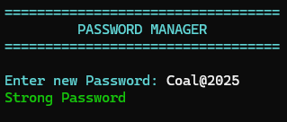
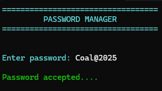
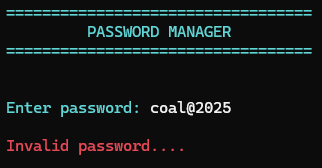

# Assembly Password Manager
A console-based Password Manager developed in **x86 Assembly (MASM)** using the **Irvine32** library. This project was created as part of the **Computer Organization and Assembly Language (COAL)** course at **FAST National University**.
The application allows users to create a password on first launch, validates its strength, encrypts it using bitwise rotation, and stores it in a file. On subsequent runs, it decrypts the stored password and verifies the user's login attempt.
---
## Features
- Create a password on first launch
- Password strength validation requiring:
  - At least one uppercase letter
  - At least one digit
  - At least one symbol
- Encrypts the password before saving it to disk
- Stores the encrypted password in a file
- Decrypts the stored password during login
- Compares user input with the stored password
- Color-coded console output for success and failure messages
- Modular implementation using Assembly procedures
---
## Technologies Used
- x86 Assembly (MASM)
- Irvine32 Library
- Microsoft Visual Studio 2022
---
## How It Works
### First Run
1. The program checks whether `userpass.txt` exists.
2. If the file is not found, the user is prompted to create a new password.
3. The password is validated to ensure it contains:
   - At least one uppercase letter
   - At least one digit
   - At least one symbol
4. The password is encrypted using the `ROL` (Rotate Left) instruction.
5. The encrypted password is saved to `userpass.txt`.
### Subsequent Runs
1. The encrypted password is loaded from `userpass.txt`.
2. The password is decrypted using the `ROR` (Rotate Right) instruction.
3. The user enters a password.
4. The entered password is compared with the decrypted password.
5. The program displays whether authentication is successful.
---
## Screenshots
### Creating a New Password

### Successful Login

### Failed Login Attempt

---
## Project Structure
```text
Password-Manager/
│
├── PasswordManager.asm
├── screenshots/
│   ├── create-password.png
│   ├── login-success.png
│   └── login-failure.png
└── README.md
```
---
## Setup
### Requirements
- Microsoft Visual Studio 2022
- MASM
- Irvine32 Library
### Installation
1. Download the following Irvine32 library files:
   - `Irvine32.inc`
   - `Irvine32.lib`
   - `SmallWin.inc`
2. Place these files in a folder (for example, `C:\Irvine`).
3. In Visual Studio:
   - Set the project platform to **Win32**.
   - Add the Irvine32 folder to:
     - **Include Directories**
     - **Library Directories**
   - Under **Linker → Input**, add:
     ```
     Irvine32.lib
     ```
4. Build and run the project.
---
## Concepts Demonstrated
- x86 Assembly programming
- Assembly procedures
- File input/output
- String manipulation
- Password validation
- Bitwise operations (`ROL` / `ROR`)
- Register management
- Modular program design
---
## License
This project was developed for educational purposes as part of the Computer Organization and Assembly Language (COAL) course at FAST National University.
