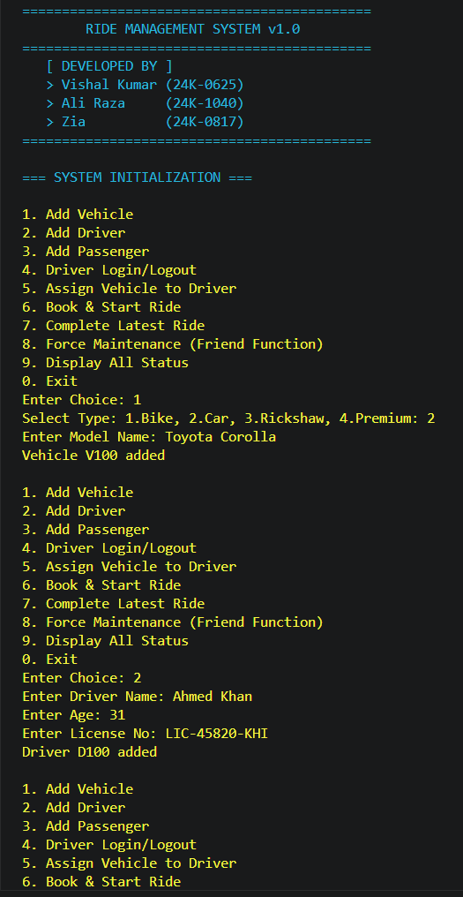
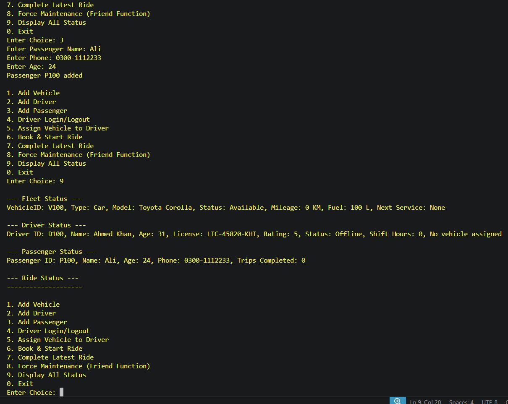

# Fleet Management System

A console based ride and fleet management system built in C++, simulating vehicle assignment, driver management, ride booking, and fare calculation for a small ride hailing style operation.

## Features

- Add and manage vehicles across four types: Bike, Car, Rickshaw, Premium
- Register drivers and passengers with validation
- Assign vehicles to online drivers
- Book, start, and complete rides with automatic fare calculation
- Driver rating and fatigue tracking based on shift hours
- Force maintenance reset via a friend function
- Full fleet status display for vehicles, drivers, passengers, and rides

## Concepts Used

- Inheritance and polymorphism through an abstract `Vehicle` base class
- Operator overloading for custom object output
- Function and constructor overloading
- Templates, a custom `FixedPointerList` container class
- Friend functions and friend classes
- Exception handling for invalid input and failed operations

## Tech Stack

- C++
- Windows API, used only for console text coloring

## How to Run

This project uses `windows.h`, so it builds on Windows only.

```
g++ src/main.cpp -o fleet_system
fleet_system.exe
```

## Sample Output

**Adding a vehicle, driver, and passenger**



**Displaying full fleet status**



## Known Limitations

- Windows only, due to the `windows.h` dependency for console coloring
- Fixed size containers, capped at 50 entries each for vehicles, drivers, passengers, and rides
- No file persistence, all data resets when the program exits

## Author & Contributions

Originally built as a group assignment for a university OOP course.

**Vishal Kumar** — full implementation: system architecture, class design, ride and fare logic, and exception handling.

**Zia** — designed and built the console interface, including the menu structure and input flow users interact with.

**Ali Raza** — prepared and delivered the project presentation, including explaining the system design, class structure, and live demo to the course instructor.

## Project Structure

```
fleet-management-system/
├── src/
│   └── main.cpp
├── screenshots/
│   ├── ss01.png
│   └── ss02.png
├── README.md
└── .gitignore
```