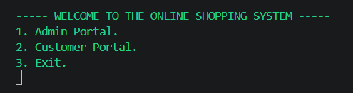
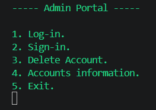
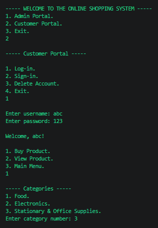
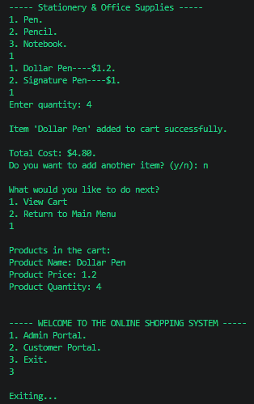
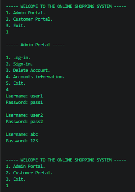
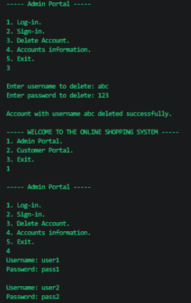

# Shopping System

A console-based **Shopping System** developed in **C** as a university programming project. The application provides separate **Admin** and **Customer** portals, allowing users to manage accounts, browse products, purchase items, and maintain a shopping cart through a menu-driven interface.

---

## Features

- Separate Admin and Customer portals
- User registration and login system
- Account deletion with credential verification
- Admin can view all registered accounts
- Product catalog organized into multiple categories
- Shopping cart with quantity selection
- Automatic total cost calculation
- View cart contents at any time
- Console-based menu-driven interface

---

## Technologies Used

- C
- Windows API (`windows.h`) for console color output

---

## How It Works

### Admin Portal

- Register new accounts
- Log in to existing accounts
- Delete user accounts
- View all registered accounts

### Customer Portal

- Register or log in to an account
- Browse product categories
- Select products and quantities
- Add items to the shopping cart
- View purchased items and total cost

---

## Screenshots

### Main Menu

<p align="center">
  
</p>

### Admin Portal

<p align="center">
  
</p>

### Customer Workflow

<p align="center">
  
  
</p>

### Account Deletion

<p align="center">
  
  
</p>

---

## Project Structure

```text
shopping-system/
│
├── main.c
├── README.md
└── screenshots/
    ├── main-menu.png
    ├── admin-portal.png
    ├── customer-workflow-1.png
    ├── customer-workflow-2.png
    ├── account-deletion-1.png
    └── account-deletion-2.png
```

---

## Setup

### Requirements

- Windows operating system
- GCC or any C compiler

### Build

```bash
gcc main.c -o main
```

### Run

```bash
./main
```

---

## Concepts Demonstrated

- Structured programming
- Functions
- Arrays
- Structures
- File handling
- User authentication
- Menu-driven application design
- Input validation
- String manipulation
- Shopping cart implementation

---

## License

This project was developed for educational purposes as part of a university programming course.